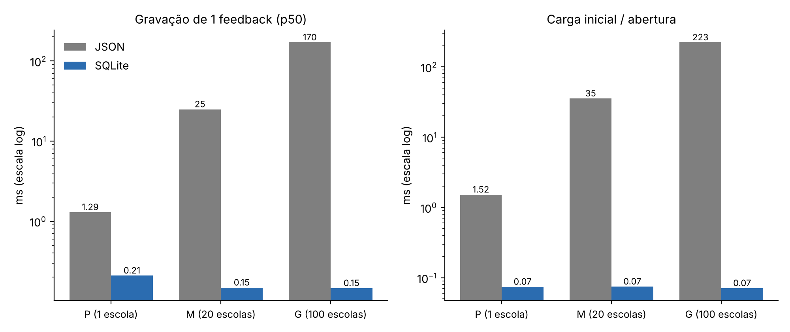

# Resultados da avaliação técnica

Ambiente **V** (máquina virtual Linux, Intel Xeon 2 vCPU, 7,8 GB de RAM, Node.js 22.23).
Dados **fictícios**, gerados por `bench/gerar-base.js` e pelos próprios scripts.
Cenários: **P** = 1 escola (200 alunos, 2.000 feedbacks) · **M** = 20 escolas (4.000 alunos, 40.000 feedbacks) · **G** = 100 escolas (20.000 alunos, 200.000 feedbacks).

## Testes funcionais — `npm test`

| Caso | O que verifica | Resultado |
|---|---|---|
| CT01 | Login com senha correta (200) e incorreta (401, sem dizer qual campo errou) | Aprovado |
| CT02 | Professora não recebe dados pessoais; rotas da coordenação devolvem 403 | Aprovado |
| CT03 | Coordenação cria, edita e remove aluno | Aprovado |
| CT04/05 | Atendimento rápido sem IA devolve 3 atividades completas pelo motor de regras | Aprovado |
| CT06 | O que é enviado ao Ollama não contém nome, nascimento, responsável, telefone nem documentos; com a IA falhando, as regras assumem (`regras-fallback`) | Aprovado |
| CT07 | Atividade marcada como "Não funcionou" não volta a ser sugerida | Aprovado |
| CT08 | Chave da OpenAI salva não é devolvida pela API | Aprovado |
| CT09 | Dados e sessão de login sobrevivem ao reinício do servidor | Aprovado |
| CT10 | `data/db.json` da versão 1.0 é importado para o SQLite sem perda | Aprovado |

## Persistência: JSON x SQLite — `bench/persistencia-json-vs-sqlite.js` (tempos em ms)

| Cenário | Estratégia | Tamanho (MB) | Carga inicial | Consulta p50 / p95 | Gravação p50 / p95 |
|---|---|---|---|---|---|
| P | JSON | 0,46 | 1,52 | 0,013 / 0,032 | 1,29 / 1,70 |
| P | SQLite | 0,33 | 0,07 | 0,008 / 0,013 | 0,21 / 0,34 |
| M | JSON | 9,44 | 35,4 | 0,257 / 0,314 | 24,9 / 33,3 |
| M | SQLite | 5,93 | 0,08 | 0,011 / 0,019 | 0,15 / 0,24 |
| G | JSON | 47,67 | 222,5 | 1,192 / 1,948 | 170,2 / 205,0 |
| G | SQLite | 30,72 | 0,07 | 0,012 / 0,020 | 0,15 / 0,19 |

## Integridade sob escrita concorrente — `bench/integridade-concorrencia.js`

4 processos × 250 registros, 3 rodadas.

| Rodada | JSON: gravados / perdidos | Leituras de arquivo pela metade | SQLite: gravados / perdidos |
|---|---|---|---|
| 1 | 700 / 300 (30%) | 2.098 | 1.000 / 0 |
| 2 | 131 / 869 (87%) | 4.131 | 1.000 / 0 |
| 3 | 504 / 496 (50%) | 4.077 | 1.000 / 0 |

## Carga na API real: versão 1.0 (JSON) x 1.1 (SQLite) — `bench/carga-versoes.js`

Login como professora; `GET /api/activities` = Atendimento rápido pelo motor de regras; `POST /api/feedbacks` = registro de feedback. Sem erros em nenhuma rodada.

| Cenário | Rota | Usuárias simultâneas | v1.0 vazão (req/s) | v1.0 p50 / p95 (ms) | v1.1 vazão (req/s) | v1.1 p50 / p95 (ms) |
|---|---|---|---|---|---|---|
| P | GET /api/activities | 10 | 2.177 | 4,2 / 9,6 | 2.060 | 4,2 / 9,7 |
| P | GET /api/activities | 50 | 4.392 | 9,5 / 25,4 | 4.538 | 9,9 / 22,9 |
| P | POST /api/feedbacks | 10 | 244 | 32,6 / 71,7 | 2.597 | 2,8 / 11,5 |
| P | POST /api/feedbacks | 50 | 206 | 233,9 / 255,7 | 3.987 | 11,9 / 22,7 |
| M | GET /api/activities | 10 | 1.018 | 7,8 / 17,2 | 1.337 | 6,3 / 14,1 |
| M | GET /api/activities | 50 | 1.159 | 34,7 / 66,3 | 1.678 | 25,6 / 43,3 |
| M | POST /api/feedbacks | 10 | 10,9 | 738 / 1.588 | 3.542 | 1,9 / 9,2 |
| M | POST /api/feedbacks | 50 | 10,9 | 4.416 / 4.637 | 5.525 | 8,5 / 19,5 |

## Latência da IA — `bench/latencia-ia.js`

Depende do hardware de cada máquina. Ensaio de 10/11/2026 no computador de referência E2
(notebook Dell Latitude 3420, Intel Core i5-1135G7, 4 núcleos/8 threads, 15,7 GB, Windows 11 Pro,
Node.js 24.21, Ollama 0.34.0, sem GPU dedicada). Uma chamada a frio e cinco a quente por modelo;
com cinco repetições, o p95 é o maior tempo observado. Meta do RNF08: p95 ≤ 30 s.

| Modelo | Máquina | Partida a frio (s) | p50 (s) | p95 (s) | Tokens/s | Respostas válidas |
|---|---|---|---|---|---|---|
| llama3.2:1b | E2 | 77,6 | 59,7 | 67,3 | 13,5 | 100% |
| llama3.2:3b | E2 | 133,3 | 92,4 | 99,5 | 8,2 | 100% |
| qwen2.5:7b | E2 | 260,9 | 156,6 | 160,4 | 4,3 | 100% |

Nenhum modelo atendeu à meta em CPU nessa máquina. Falta repetir no computador da escola (E1)
e em um servidor com GPU (perfil C): `node bench/latencia-ia.js llama3.2:1b llama3.2:3b qwen2.5:7b`.
